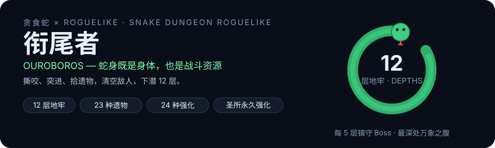
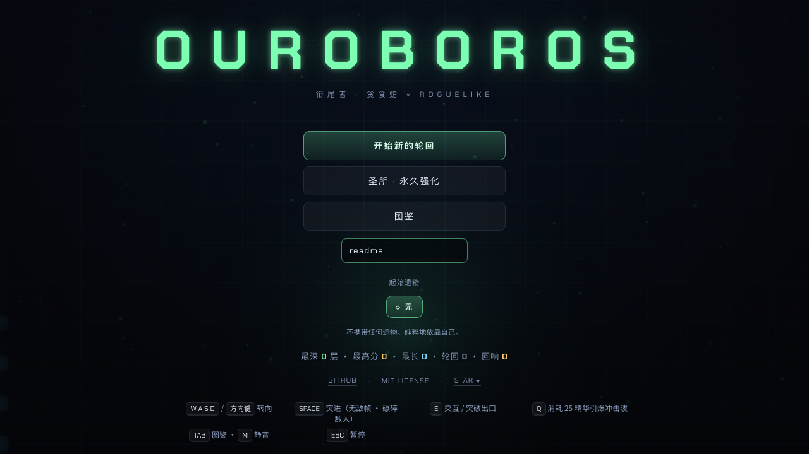
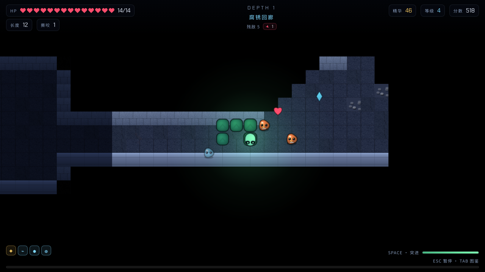

<p align="right"><a href="README.md">中文</a></p>

<p align="center">
  
</p>

<p align="center">
  <a href="https://rogue-snake.xiaosang.cc/">▶ Play Online</a>
  ·
  <a href="https://github.com/holynova/rogue-snake">GitHub Repository</a>
</p>

OUROBOROS is a snake × roguelike dungeon crawler: you are a growing snake. Bite, dash, and collect relics to clear each floor, unlock the exit, and descend 12 depths to face the final boss, 万象之腹 (the Devourer). Your body is both your health and your weapon — longer means stronger, and harder to turn.

## Screenshots

<p align="center">
  
  
</p>

## How to Play

- **Move & steer**: WASD / arrow keys to steer; the snake keeps swimming forward and grows as it eats.
- **Dash**: Space to dash (invincibility frames, crushes enemies); Q spends 25 essence to detonate a shockwave.
- **Interact**: E to interact / break through the exit; Tab opens the codex; M mutes; Esc pauses.
- **Clear floors**: wipe out a floor's enemies to unlock the exit and descend; the boss 狱卒长 (the Warden) guards every 5th floor, and the final boss 万象之腹 (the Devourer) waits at depth 12.
- **Level up**: eating and killing earn XP; on level-up, draft one of three from 24 upgrades; 23 relics can also be found in the dungeon.
- **Rebirth**: death is not the end. Echoes earned at the end of a run buy permanent upgrades in the Sanctum — the more you die, the stronger you get.

## Enemies

| Enemy | Behavior |
|------|------|
| 蚀爬者 (Acid Crawler) | The common hunter, lunging in a straight line |
| 吐酸者 (Acid Spitter) | Keeps its distance, spits corrosive shots |
| 胀爆体 (Bloat Bomber) | Explodes on death, dealing area damage |
| 穿墙影 (Wall-Phasing Shade) | A specter that ignores walls |
| 腐甲巨仆 (Rotting-Armor Brute) | Thick HP and heavy armor; killing it restores 1 HP |
| 狱卒长 (the Warden, Boss) | Guards every 5th floor; fan bullet patterns + summons reinforcements |
| 万象之腹 (the Devourer, final Boss) | Depth 12; five-way bullet patterns + summons Bloat Bombers |

## Sanctum · Permanent Upgrades

6 permanent upgrade branches (生机 Vitality, 獠牙 Fangs, 轻身 Lightfoot, 拾遗 Scavenger, 护佑 Guardian, 预兆 Omen), unlocked tier by tier with echoes; 5 starting relics (余烬 Ember, 珠鳞 Pearl Scales, 幼牙 Young Fang, 根须 Rootlets, 提灯 Lantern) and daily-seed trials can also be unlocked. Progress lives in your browser's local storage — clearing site data removes your saves.

## Run Locally

```bash
npm ci
npm run dev       # dev server
npm run build     # production build
npm test          # rules and steering acceptance tests
```

## Tech

- Phaser 3.90 + pure JavaScript, built with Vite; procedural dungeon generation (`src/dungeon.js`), seeded RNG (`src/rng.js`).
- All content is data-driven (`src/data.js`: enemies / upgrades / relics); saves use localStorage (`src/meta.js`).

```
src/main.js             Entry point
src/scenes/MenuScene.js Title / Sanctum / Codex
src/scenes/GameScene.js Main combat scene
src/dungeon.js          Procedural dungeon generation
src/run.js              Single-run state (length / essence / upgrades)
src/data.js             Content tables: 7 enemies / 24 upgrades / 23 relics
src/meta.js             Sanctum permanent upgrades and saves
src/art.js / src/audio.js   Procedural art and sound
```

## License

MIT, see `LICENSE`.
