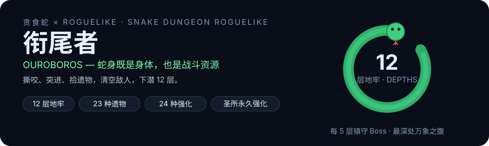
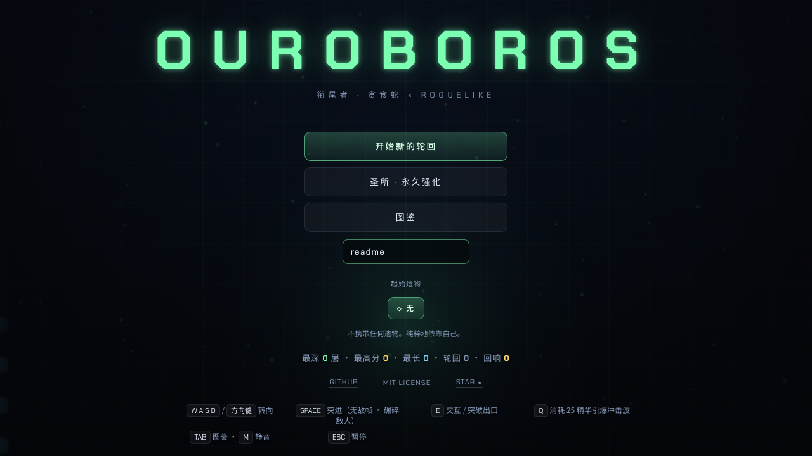
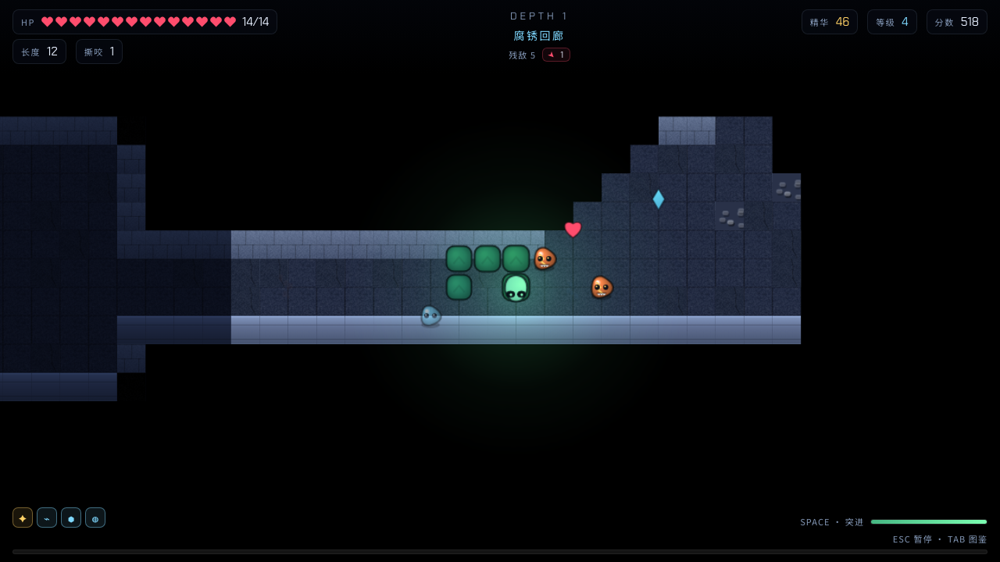

<p align="center">
  
</p>

<p align="center">
  <a href="https://rogue-snake.xiaosang.cc/">▶ 在线玩 Play Online</a>
  ·
  <a href="https://github.com/holynova/rogue-snake">GitHub 仓库</a>
</p>

衔尾者是一款贪食蛇 × Roguelike 地牢游戏：你是一条不断生长的蛇，用撕咬、突进与遗物清空每一层的敌人，解锁出口，一路下潜 12 层，直面终末 Boss 万象之腹。蛇身既是身体，也是战斗资源——长度越长，战力越强，也越难转身。

OUROBOROS is a snake × roguelike dungeon crawler: you are a growing snake. Bite, dash, and collect relics to clear each floor, unlock the exit, and descend 12 depths to face the final boss, the Devourer. Your body is both your health and your weapon — longer means stronger, and harder to turn.

## 截图 / Screenshots

<p align="center">
  
  
</p>

## 玩法 / How to Play

- **移动与转向**：WASD / 方向键转向；蛇会一直向前游动，进食变长。
- **突进**：Space 突进（带无敌帧，能碾碎敌人）；Q 消耗 25 精华引爆冲击波。
- **交互**：E 交互 / 突破出口；Tab 打开图鉴；M 静音；Esc 暂停。
- **过关**：清空当层敌人，解锁出口下潜；每 5 层有 Boss 狱卒长镇守，第 12 层是终末 Boss 万象之腹。
- **升级**：进食与击杀攒经验，升级时从 24 种强化中三选一；地牢里还能捡到 23 种遗物。
- **轮回**：死亡不是终点。结算的回响可在圣所兑换永久强化，越死越强。

## 敌人 / Enemies

| 敌人 | 行为 |
|------|------|
| 蚀爬者 | 直线扑来的常见猎手 |
| 吐酸者 | 保持距离，吐腐蚀弹 |
| 胀爆体 | 死亡时爆炸，造成范围伤害 |
| 穿墙影 | 无视墙壁的幽影 |
| 腐甲巨仆 | 厚血重甲，击杀回 1 点生命 |
| 狱卒长（Boss） | 每 5 层镇守；扇形弹幕 + 召唤援军 |
| 万象之腹（终末 Boss） | 第 12 层；五向弹幕 + 召唤胀爆体 |

## 圣所 · 永久强化 / Sanctum

6 条永久强化分支（生机、獠牙、轻身、拾遗、护佑、预兆），用回响逐级解锁；另可解锁 5 种起始遗物（余烬、珠鳞、幼牙、根须、提灯）与每日种子试炼。进度存在本机浏览器，清理站点数据会移除存档。

## 本地运行 / Run Locally

```bash
npm ci
npm run dev       # 开发服务器
npm run build     # 生产构建
npm test          # 规则与转向验收测试
```

## 技术 / Tech

- Phaser 3.90 + 纯 JS，Vite 构建；程序化地牢生成（`src/dungeon.js`），种子随机（`src/rng.js`）。
- 内容全部数据驱动（`src/data.js`：敌人 / 升级 / 遗物）；存档用 localStorage（`src/meta.js`）。

```
src/main.js             入口
src/scenes/MenuScene.js 标题 / 圣所 / 图鉴
src/scenes/GameScene.js 战斗主场景
src/dungeon.js          程序化地牢生成
src/run.js              单局状态（长度 / 精华 / 升级）
src/data.js             内容表：7 敌人 / 24 升级 / 23 遗物
src/meta.js             圣所永久强化与存档
src/art.js / src/audio.js   程序化美术与音效
```

## English

**OUROBOROS / Rogue Snake** is a snake × roguelike dungeon crawler: bite, dash, and loot your way down 12 procedurally generated depths.

- **Your body is your weapon**: eat to grow longer; length is power — and a turning liability.
- **Combat**: WASD / arrows to steer, Space to dash (i-frames, crushes enemies), Q to detonate a shockwave for 25 essence, E to interact, Tab for the codex.
- **Content**: 7 enemy types (5 regulars + 2 bosses: the Warden every 5 floors, the Devourer at depth 12), 24 level-up upgrades, 23 relics.
- **Meta-progression**: echoes earned each run buy 6 permanent Sanctum branches and unlock 5 starting relics plus daily-seed trials. Saves live in localStorage.
- **Run it**: `npm ci && npm run dev`. Tests: `npm test` (rules + steering acceptance).
- **Tech**: Phaser 3.90 + vanilla JS + Vite; procedural dungeons (`src/dungeon.js`), seeded RNG (`src/rng.js`), data-driven content (`src/data.js`).

## 许可 / License

MIT，见 `LICENSE`。
