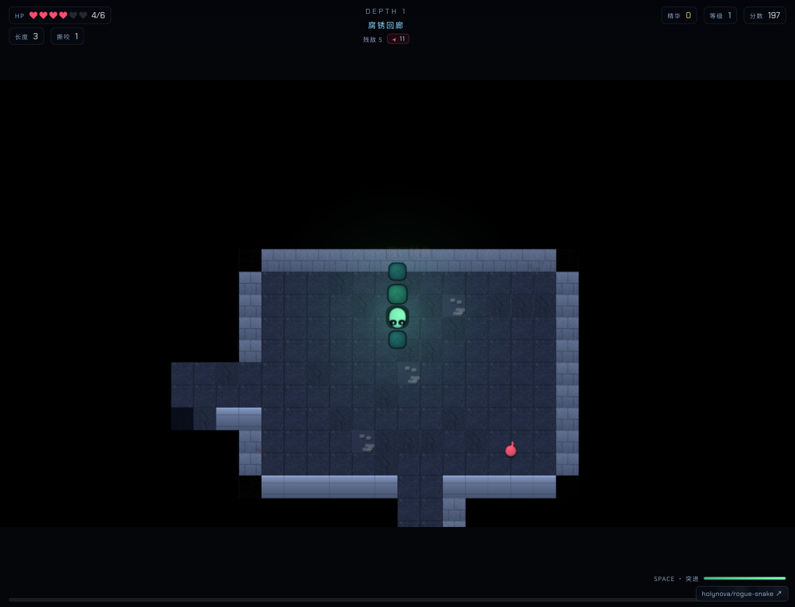

# 衔尾者 · OUROBOROS / Rogue Snake

用不断生长的蛇身穿过地牢，通过撕咬、突进与遗物升级清空敌人并下潜。

A snake dungeon roguelike where body length, dash attacks and relics shape each run.

[在线体验](https://rogue-snake.xiaosang.cc/) · [源码](https://github.com/holynova/rogue-snake)



## 可以做什么

- 长度既是身体也是战斗资源。
- 清空敌人解锁出口，结算回响用于永久强化。

## 怎么玩

WASD转向，Space突进，E交互，Q冲击波，Tab图鉴，Esc暂停。

## 本地运行

```bash
npm ci
npm run dev
# 生成生产产物
npm run build
```

运行 `npm test` 检查已有游戏规则与转向验收。进度保存在本机浏览器，清理站点数据会移除存档。

许可证见 [LICENSE](LICENSE)。


## 发布

```bash
npm run build
npx --yes wrangler@4.128.0 deploy --config wrangler.jsonc
```

从 `master` 同一提交在本地手动发布到Cloudflare Workers。正式地址：[https://rogue-snake.xiaosang.cc/](https://rogue-snake.xiaosang.cc/)。
